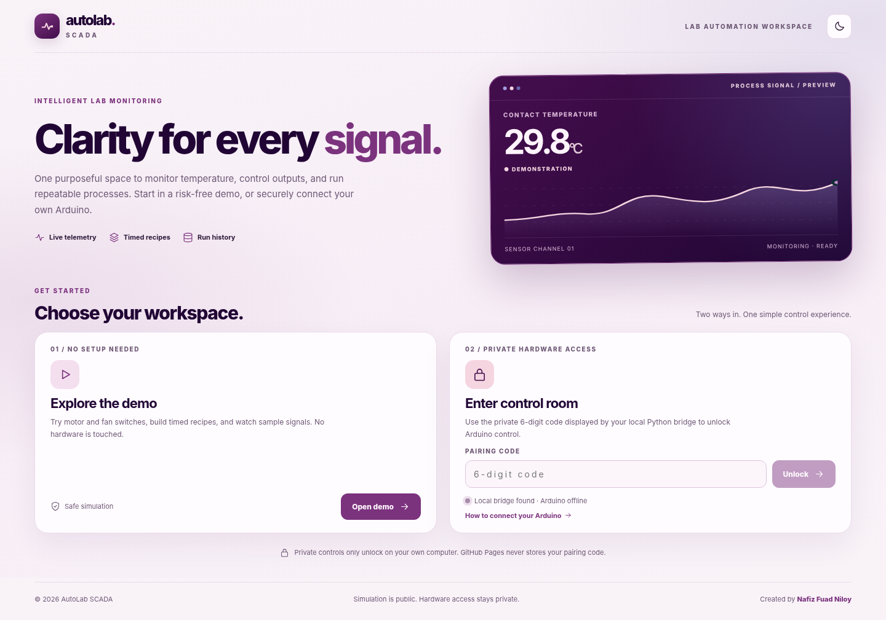
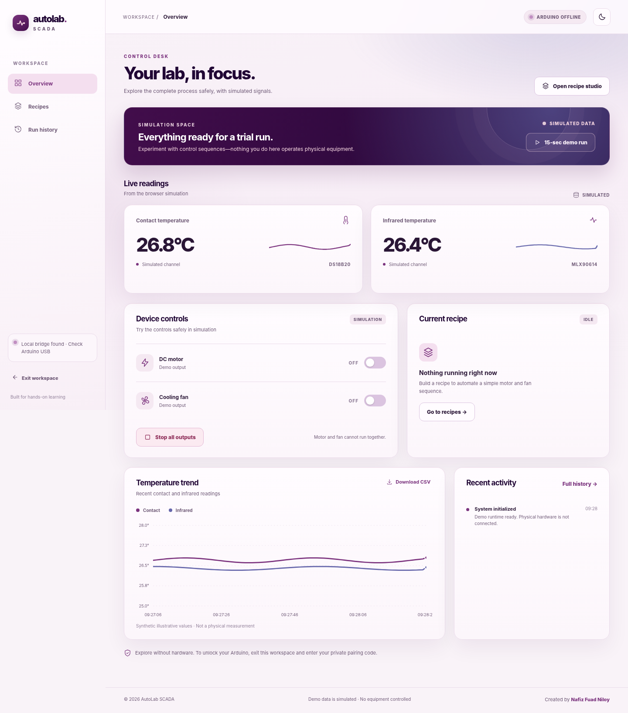

# AutoLab SCADA

**A practical Arduino-based laboratory automation and monitoring workspace.**

AutoLab SCADA combines a browser-based supervisory interface, a programmable Arduino controller, and a Python gateway into one experimental system. It supports **live temperature monitoring**, **manual motor and fan control**, **timed automation recipes**, and **recorded experiments**. A fully independent simulator lets anyone explore the interface without physical hardware.

> **Project by Nafiz Fuad Niloy.** Developed as an educational laboratory automation prototype. It is **not** a certified industrial SCADA or safety system.



## At a glance

| Feature | Public demo | Private Arduino workspace |
| --- | --- | --- |
| Browser welcome screen | Open without login | Enter a fixed operator PIN (privately stored on the host) |
| Contact and IR temperature | Clearly labeled synthetic readings | Measured DS18B20 and MLX90614 readings |
| Motor and fan switches | Browser-only simulated outputs | Arduino relay output commands |
| Programmable timed recipes | Browser timing engine | Arduino firmware timing engine |
| Events and trends | Simulated activity and charts | Arduino events and measured telemetry |
| Experiment history | Browser `localStorage` | Local SQLite database |
| Light/dark themes | Yes | Yes |
| CSV/JSON export | Yes | Yes, where supported by the view |



## Why this project exists

Many small laboratory experiments need repeatable actuator sequences and a convenient view of sensor values, but do not require a full-scale industrial SCADA installation. AutoLab SCADA explores that middle ground using commonly available hardware and lightweight, inspectable software.

The application separates **monitoring** (sensor readings, status, trends), **supervisory operation** (start/stop, manual outputs, recipes) and **recordkeeping** (event timestamps, sample history). It is intended for learning about process automation, microcontroller communication, measurement and experimental repeatability.

## Interface and workflow

**Screen 1 — Welcome and access.** Visitors can choose **Open demo** immediately. If the local backend and Arduino are ready, an authorized user can enter the fixed six-digit operator PIN to access the real control room. Backend presence alone does **not** authorize physical control.

**Screen 2 — Workspace.** The application exposes three focused views:

- **Overview:** measured/simulated temperature cards, relay command indicators, output switches, STOP, process progress, a scrolling trend chart and activity log.
- **Recipes:** a step editor with motor/fan selection, duration, repeat count, saved presets and run control.
- **Run history:** previous sessions and associated timing information, with exports where available.

The interface uses a five-color **Moon palette** (`#F5D5E0`, `#6667AB`, `#7B337E`, `#420D4B`, `#210635`), responsive layouts, a light/dark appearance switch, and separate data-source labels. Preferences and demo recipes are saved locally in the browser.

## Hardware

The project was built around the existing Arduino laboratory hardware rather than requiring new equipment.

| Component | Connection / role |
| --- | --- |
| Arduino Uno | Serial controller at 115200 baud over USB |
| DS18B20 | Contact-temperature sensor, 1-Wire at **D2** |
| MLX90614 | Non-contact infrared temperature sensor, **I²C** |
| 16×2 I²C LCD | Local status display on shared I²C bus |
| DC motor relay | Command output at **D7** |
| Fan relay | Command output at **D6** |
| 12 V motor and fan | Independently powered loads controlled through relays |
| Buzzer | Hardware-specific pin; **verify wiring and firmware** before use |

**Important:** The referenced hardware report contains a buzzer pin discrepancy (D8 versus D11). Relay trigger polarity, wiring, contact ratings, motor inductive protection, grounding and I²C pull-up voltage compatibility must be checked on the actual setup. This repository does **not** by itself establish the safety of any external wiring.

The UI displays *commanded* relay states. It cannot prove that a relay contact moved, a motor rotated, or a fan produced airflow; those measurements would require separate feedback hardware. Likewise, contact and IR sensors need not measure exactly the same physical temperature.

## Architecture

```text
                        GitHub Pages (static frontend)
                        ┌─────────────────────────┐
                        │ Welcome / Demo / Login  │
                        │ Dashboard & visual tools│
                        └────────────┬────────────┘
                                     │ paired HTTPS API requests (Tailscale Funnel)
                                     ▼
              HTTPS: your-device.tailnet.ts.net → 127.0.0.1:8000
                        ┌─────────────────────────┐
                        │ Python FastAPI gateway  │
                        │ Pairing + request checks│
                        │ SQLite sample historian │
                        └────────────┬────────────┘
                                     │ PySerial at 115200 baud
                                     ▼
                        ┌─────────────────────────┐
                        │ Arduino Uno firmware    │
                        │ Sensors, timers, relays │
                        │ Interlock and watchdog  │
                        └─────────────────────────┘

Demo path: Web browser → independent JS simulator → browser localStorage.
```

The static frontend **cannot run Python on GitHub Pages** or control a USB Arduino by itself. The operator's laptop runs FastAPI on `127.0.0.1:8000`. **Optional Tailscale Funnel** supplies a publicly reachable HTTPS reverse proxy; the authenticated browser then reaches the same backend from anywhere. The URL in `src/remote-config.js` is public and contains no credentials. Without Funnel configuration, the site can still use the local loopback backend on the laptop.

### Technology stack

- **Frontend:** HTML, modern CSS, vanilla JavaScript ES modules and inline SVG charts; no front-end build framework required.
- **Demo engine:** an independent browser state machine with synthetic channels, recipe timers and local history.
- **Local API:** Python, FastAPI, Uvicorn, Pydantic, PySerial and WebSocket support.
- **Storage:** SQLite for hardware telemetry, firmware events, steps and runs; `localStorage` for demo data and appearance preferences.
- **Controller:** Arduino serial protocol with framed commands, acknowledgements, telemetry and events.

## Run the demo

**Online:** [AutoLab SCADA on GitHub Pages](https://nf-niloy.github.io/autolab-scada/).

**Locally (frontend only):**

```powershell
cd D:\autolab-scada
python -m http.server 8001
```

Open `http://127.0.0.1:8001` and select **Open demo**. Use a web server instead of double-clicking `index.html`, because the frontend uses ES modules. Alternatively, run `run_local.bat` on Windows or `./run_local.sh` on Linux/macOS to start a local preview at `http://127.0.0.1:8765`.

In demo mode, the motor/fan actions, temperatures and recorded timings are **simulated** and do not connect to physical equipment. You can build recipes and export illustrative traces without a backend.

## Connect a real Arduino (Windows)

**Prerequisites:** a connected and correctly configured Arduino with compatible AutoLab serial firmware, Python 3.10+ and an available USB COM port. Close the Arduino Serial Monitor and other applications using that COM port.

1. Back up your working project folder and **keep your existing SQLite database**.
2. In PowerShell, install the local gateway dependencies:

   ```powershell
   cd D:\autolab-scada\backend
   python -m pip install -r requirements.txt
   ```

3. Start the gateway, bound **only** to the local computer:

   ```powershell
   python -m uvicorn main:app --host 127.0.0.1 --port 8000
   ```

   Or double-click `run_live.bat` from the project folder.

4. If your Arduino is not on the default `COM6`, set the port before starting:

   ```powershell
   $env:ARDUINO_PORT = 'COM5'   # replace with your actual port
   python -m uvicorn main:app --host 127.0.0.1 --port 8000
   ```

5. One time, before starting the backend, run `python setup_pin.py` from the `backend` folder and enter your chosen six-digit PIN twice. It is stored as a salted hash in the ignored `backend/.local/credentials.json`; the terminal will **not** print it again. If the bridge was already running, restart it after setup.
6. Open `http://127.0.0.1:8000`, or the GitHub Pages site on the same laptop. Choose the private-control path and enter your fixed code. **Never commit the PIN or share it publicly.**
7. Verify sensor readings and status **before** running manual outputs or any recipe. Keep a physical power cutoff available throughout the experiment.

Backend routes include public, **redacted** `GET /api/status`; authenticated telemetry/history (`GET /api/status`, `/api/history`, `/api/runs` with a bearer session); and protected actuator/recipe requests (`POST /api/motor`, `/api/fan`, `/api/stop`, `/api/recipe/run`). Read-only WebSocket `/ws/live` requires a session token as its first message. API docs are deliberately disabled on the remote-exposable backend. Avoid issuing actuator commands unless you understand their physical effect.

### Recipe bounds

| Constraint | Demo | Hardware |
| --- | --- | --- |
| Steps per recipe | 1–12 | 1–8 |
| Duration per step | 2–180 seconds | 2–120 seconds |
| Repeat cycles | 1–5 | 1–20 |
| Motor and fan simultaneously ON | Blocked | Blocked |

Live recipes are sent to the Arduino for execution; browser scheduling does not determine the firmware's step timing. Event-derived step intervals are **not** measurements of relay contacts or mechanical response.

## Remote access over Tailscale Funnel (optional)

This is a **remote-control prototype for low-risk supervised laboratory hardware**, not an unattended or safety-critical service. Funnel exposes the backend to the public internet, so a six-digit PIN alone is not strong authentication. Use this only with nonhazardous loads, a physical cutoff, and supervision. Never use this for heaters, batteries or other hazardous actuators without independent certified safety hardware.

1. Back up your existing `D:\autolab-scada` folder and keep `backend/autolab_history.sqlite3` and your working Arduino firmware.
2. One-time fixed PIN setup: from `D:\autolab-scada\backend` run `python setup_pin.py`. Type your six-digit PIN privately; it is hashed locally. The PIN is **not** hardcoded in any web, Python or GitHub source file. `backend/.local/` is ignored by Git.
3. Ensure Tailscale for Windows is installed and signed in. Find the device's MagicDNS hostname (`your-device.your-tailnet.ts.net`) in the Tailscale admin panel or from `tailscale status --json`. **Do not enable Funnel yet.**
4. From the project root run `python backend/configure_remote.py https://your-device.your-tailnet.ts.net` using the actual hostname. This creates the host-only `.local/remote.json` and updates the publicly committed `src/remote-config.js` (URL only; no PIN).
5. Run the FastAPI backend on `127.0.0.1:8000`, verify `/api/status` reports telemetry and the device is safe and OFF. Then start Tailscale Funnel: `tailscale funnel --bg 8000`. Follow any Tailscale approval prompts. Check the Funnel URL with a second device **before testing outputs**.
6. Push the updated frontend sources to GitHub Pages. Its welcome page now discovers your configured HTTPS endpoint from anywhere; **Open demo** still never touches the Arduino. Private code unlocks the actual control room.
7. To disable public access, run `tailscale funnel 8000 off` (check `tailscale funnel status`). Stop the Python bridge or disconnect external actuator power when not using the prototype.

Funnel's stable HTTPS URL is a transport, **not** an authentication layer. A plain public link is never sufficient to authorize physical commands. This version adds a locally hashed persistent PIN, five-strike one-hour global lockout, random per-browser two-hour bearer sessions, read protection for history and measured telemetry, strict GitHub Pages origin/Host checks, and a ~25-second operator heartbeat lease. If an active operator browser stops communicating, the backend requests `STOP`. If the STOP acknowledgement fails, the bridge suspends its serial heartbeat so the Arduino firmware watchdog can take over. **Neither software STOP nor the watchdog is a certified emergency stop.** Keep a physical cutoff and a local supervisor who can intervene; loss of internet never proves that hardware is de-energized.

**Important:** The code used in a conversation or shared with others should be considered exposed; choose a new PIN before making a public Funnel accessible. Six-digit codes remain weak by design; a stronger additional authentication factor is recommended before broad deployment. The rate limit is global and can be abused to temporarily lock out legitimate operators.

## Security and operational safety

- Backend **still binds only to `127.0.0.1`**, never `0.0.0.0`. Funnel proxies HTTPS requests to that loopback service. The Host allowlist is updated from a private `.local/remote.json`.
- Remote API access is restricted to the official GitHub Pages origin and localhost (note: CORS is not authentication); bearer sessions protect actuator commands and measured data.
- The public status endpoint reports only connection readiness, not actual sensor values, event logs or motor state.
- Each correct PIN login gets a unique token; sessions expire after two hours (and after inactivity). No shared permanent bearer token is published.
- The browser refreshes its session while Live Mode is active. Loss of its heartbeat triggers a STOP request; this is a software safety layer only, not a physical guarantee.
- The Arduino independently enforces startup OFF, interlocks, bounded recipes and serial host timeout. The UI reports commanded outputs, not independently verified relay contacts.
- **Maintain a reachable physical power disconnect.** Do not remotely operate unattended hazardous equipment. Never rely on a web button or tunnel for an emergency stop.

## Data and exports

The hardware database defaults to `backend/autolab_history.sqlite3`. It stores readings, Arduino event records, recipes/runs and step intervals. Back it up separately before making deployment changes. The repository's `.gitignore` excludes SQLite files and local configuration so experimental data and private files are not accidentally committed.

Demo runs, saved recipes and theme preference are browser-local. Clearing browser site data can remove them. The frontend's CSV export identifies whether values came from **SIMULATED** or **HARDWARE** sources; never describe simulated values as experimental measurements.

## Repository structure

```text
index.html                  Two-screen HTML shell and branding
assets/styles.css           Responsive Moon-palette light/dark interface
assets/favicon.svg          AutoLab identity mark
src/app.js                  Pages, actions, recipe editor, data presentation
src/live-controller.js      Paired local/HTTPS API adapter and live state
src/remote-config.js        Public API URL (NO secrets)
src/simulator.js            Independent demo state machine
src/recipes.js              Demo recipes and validation
src/charts.js               Temperature trends and sparklines
src/storage.js              Browser persistence and exports
src/icons.js                Interface SVG icons
backend/main.py             FastAPI, serial bridge, historian and protected sessions
backend/setup_pin.py        One-time private PIN configuration
backend/configure_remote.py One-time Funnel URL configuration
backend/.local/             Machine-private hashed PIN and host (gitignored)
backend/requirements.txt    Python dependencies
run_live.bat                 Start local hardware bridge (Windows)
run_local.bat / run_local.sh Static demo launch scripts
docs/                       Setup, validation and design previews
tests/                      Backend and frontend regression checks
```

## Testing and validation

From the project root:

```powershell
python -m unittest discover -s tests
node tests/test_frontend.mjs
node tests/test_autolab_ui.mjs
node --check src/app.js
```

Browser smoke tests can validate visual layout, demo navigation, theme switching and pairing with **mocked** backend responses. The local Arduino communication, relay response and GitHub Pages loopback permission path must be rechecked on the intended computer after a new deployment. See [Validation checklist](docs/VALIDATION.md).

## Troubleshooting

| Symptom | Likely cause / action |
| --- | --- |
| Welcome page says Arduino offline | Confirm USB cable, correct `ARDUINO_PORT`, uploaded firmware and that Serial Monitor is closed |
| Dashboard shows simulated temperatures | You selected **Open demo**; choose private control from the welcome screen to use measured data |
| Control remains unavailable | Check fixed PIN setup, connected Arduino, fresh telemetry, and whether the browser session expired |
| Phone says offline while laptop is online | Configure Funnel host with `backend/configure_remote.py`, enable approved Funnel, push the updated `src/remote-config.js` |
| `No supported WebSocket library detected` | Install dependencies with `python -m pip install -r backend/requirements.txt` |
| Database appears missing after an update | Look for the previous `backend/autolab_history.sqlite3` backup; don't commit or overwrite it |
| Two conflicting motor/fan commands | Interlock intentionally prevents both channels being ON simultaneously |

## Credits

**Created by [Nafiz Fuad Niloy](https://github.com/nf-niloy).**

Built around an Arduino-based laboratory project and expanded into an interactive simulation and a separately authorized hardware monitoring/control interface. Demo and private live operating modes intentionally share a visual language while keeping their data sources and control paths separate.
