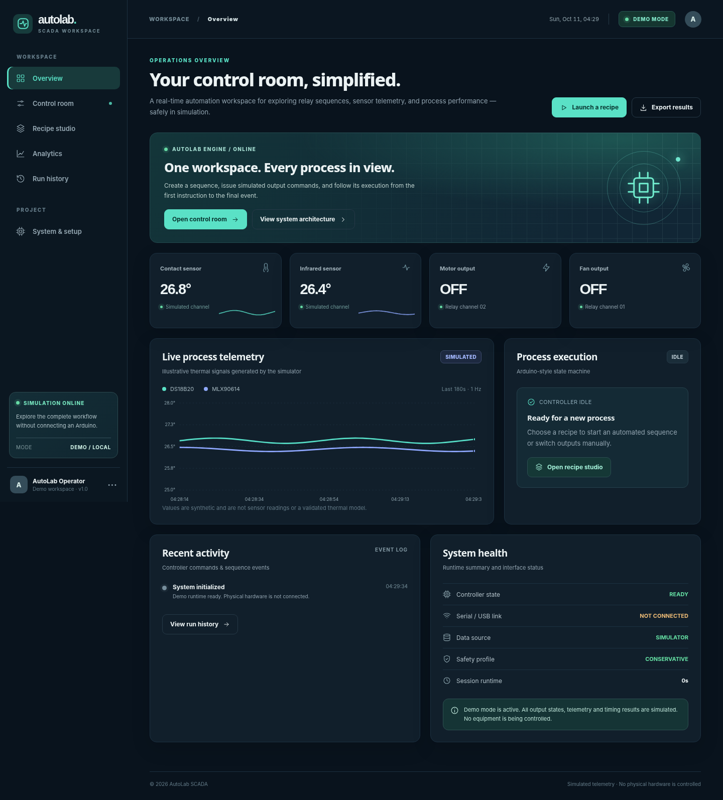

# AutoLab SCADA

A self-contained, professional, industrial-style automation **browser simulator**. Build timed motor/fan processes, explore telemetry, test safe-stop and fault handling, track run metrics, and export simulated run data. Built for a standalone GitHub Pages repository.



> **IMPORTANT: Demo only.** This release does **not** communicate with an Arduino. Values and output states are explicitly **SIMULATED**. It is not a production industrial SCADA system, a safety controller, or verified experimental hardware data.

## Run locally

You need only a browser and a local static server; no Node.js or dependency installation is required. On Windows you may double-click `run_local.bat` if Python is installed. On Linux/macOS you can execute `./run_local.sh`.

```bash
cd autolab-scada
python -m http.server 8000
```

Open <http://localhost:8000>. Use an HTTP server rather than opening `index.html` as `file://`, because this site imports JavaScript ES modules.

## Features in this version

- Responsive dark industrial UI: overview, control room, recipe studio, analytics, run history, system documentation.
- Interactive **simulated** manual motor/fan commands, with conservative interlock to block simultaneous ON states.
- Local recipe editor with add/remove steps, 2–180 second duration validation, repeat cycles, JSON persistence to `localStorage`.
- Simulated timed recipe execution, pause, resume, safe stop, test-fault injection, reset, event log and step timing analytics.
- Synthetic DS18B20/MLX90614-style temperature channels (illustrative, **not physically validated**), live SVG charts.
- Local run history, run detail view, synthetic telemetry CSV export, and JSON backup.
- Zero third-party JS dependencies and no build process. Deploy straight to GitHub Pages.

## Publish as a *separate* GitHub Pages site

1. Create a new public GitHub repository, e.g. `autolab-scada`. Do **not** upload it to your personal portfolio repository.
2. Upload **all files and folders in this project** to the repository root; keep `index.html` in the root.
3. In that repository, open **Settings → Pages**. Set **Deploy from a branch**, branch `main`, folder `/(root)`. Save.
4. Your app's URL will normally become `https://YOUR_USERNAME.github.io/autolab-scada/` (GitHub can take a few minutes to deploy).
5. In your existing portfolio, add only a project title, description, and a hyperlink to this GitHub Pages site and/or its source repository.

Because all references are relative (`./`), no Vite `base` or custom deployment workflow is necessary.

## What the demo measures — and what it does not

Simulation runtime, synthetic thermal traces, step completion counts, browser interval scheduling error, simulated relay commands, and a demo fault recovery can be explored. None of these results are measurements of an Arduino or a relay contact. Real Arduino timing requires timestamped firmware events; physical relay contact timing or motor RPM require additional sensors that this hardware kit does not have. The two temperature sensors should not be indiscriminately averaged, and IR sensing depends on emissivity and geometry.

## Planned local hardware integration (not included)

The existing project reports these components: Arduino Uno, DS18B20 (D2), MLX90614 (I²C A4/A5), 16×2 I²C LCD, fan relay (D6), motor relay (D7), buzzer, 12 V fan, 12 V motor, power supply, toggle switch. The report contains a buzzer pin discrepancy (**wiring D8 vs firmware D11**). Check actual wiring, active-HIGH/LOW relay inputs, rated supply/contacts, inductive protection and 3.3V/5V I²C pull-up compatibility before connecting to a new firmware. No changes should be made to battery/12V wiring without competent verification.

Future stages:

```text
GitHub Pages public demo:        browser simulator (no real control)
Local hardware installation:    Arduino Uno <--USB--> Python FastAPI/PySerial <--localhost--> browser
```

Keep relay-control endpoints bound to `127.0.0.1` and avoid unauthenticated public access. Arduino must enforce startup-OFF, fault safe-stop, input validation, bounded recipe durations, watchdog timeouts, and explicit re-arming after disconnection. Browser-level stop buttons are **not** certified emergency stops.

## Structure

```text
index.html           App shell / navigation
assets/styles.css    Responsive visual design
assets/favicon.svg   Branding
src/app.js           Page rendering and interactions
src/simulator.js     Browser simulation and state machine
src/recipes.js       Recipe validation and local storage integration
src/charts.js        SVG charts without dependencies
src/icons.js         Inline SVG iconography
src/storage.js       Export utilities and localStorage helpers
docs/                Project and evaluation notes
```

## Portfolio description

**AutoLab SCADA — Industrial Automation Simulator.** An interactive SCADA-inspired web app for simulated actuator control, programmable process recipes, synthetic real-time telemetry, fault testing and execution analytics. A standalone GitHub Pages demonstration for a planned USB-connected Arduino automation testbed. *Current release: browser simulation; physical hardware integration planned.*

## Local data and privacy

Recipes and runs are stored only in your browser `localStorage`. Clearing site data can remove them, so use **Export all** for backups. There is no server, account system, cloud storage, or telemetry network transmission. The UI uses installed system fonts and does not need external fonts or CDN scripts.
